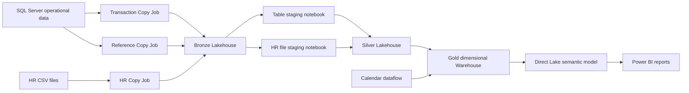

# Retail Analytics Platform

### SQL Server + Microsoft Fabric | Data Engineering, Dimensional Modelling & Business Intelligence

I designed and built an end-to-end analytics platform that transforms retail sales, purchasing, product, and workforce data into an orchestrated Microsoft Fabric solution, a dimensional data warehouse, and Power BI analysis.

This project demonstrates how I turn analytical questions into data pipelines, transformation rules, warehouse structures, KPIs, and reports—and how I make the implementation observable and reviewable.

---

## Project at a glance

| | |
|---|---|
| **Business domain** | Retail sales, promotions, procurement, and workforce operations |
| **Source systems** | SQL Server operational data and HR CSV files |
| **Data platform** | Microsoft Fabric Data Pipelines, Copy Jobs, Lakehouses, Spark, and Warehouse |
| **Analytics** | Dimensional semantic model, DAX measures, and Power BI report pages |
| **My role** | Solution design and implementation across ingestion, transformation, warehouse, semantic model, and reporting |

## Business questions the platform supports

- How do sales and product demand change by date, store, promotion, and time of day?
- Which products are purchased together, and how do promotion and product changes relate to sales?
- How do purchasing volumes and delivery times vary by product, vendor, and store?
- What patterns appear in absence, overtime, and misconduct records?
- How can sales and purchasing measures be compared across reporting periods?

I translated these analytical needs into source-to-report paths, event-retention rules, fact grains, dimensions, KPI calculations, report topics, and validation questions. The [requirements trace](documentation/business-requirements.md) links the questions to the implementation and identifies areas requiring further validation.

## Solution architecture



The master pipeline sequences **Bronze → Silver → Gold**. Separate table and file transformation paths converge in Silver; Warehouse procedures then load dimensions and facts for shared semantic-model and report consumption.

## Engineering decisions and implementation

### 1. Separate ingestion by source behavior

Transaction, reference, and HR file sources use distinct Fabric Copy Jobs rather than a single generic load. The transaction configuration uses snapshot-plus-incremental ingestion settings; reference tables use overwrite destinations; HR files land in the Bronze Files area.

- [Master orchestration](pipelines/Master_ETL_Pipeline.DataPipeline/pipeline-content.json)
- [Transaction ingestion](pipelines/Ingest_Transaction_Tables.CopyJob/copyjob-content.json)
- [Reference ingestion](pipelines/Ingest_Reference_Tables.CopyJob/copyjob-content.json)
- [HR file ingestion](pipelines/Ingest_HR_CSV_Files.CopyJob/copyjob-content.json)

### 2. Build distinct, fit-for-purpose staging paths

The table notebook standardizes and shapes SQL-ingested entities. The HR notebook applies schemas and date handling, prepares workforce records, and writes staged outputs. Keeping these paths distinct makes source-specific rules visible while bringing both into the Silver layer.

- [Table staging notebook](notebooks/Tables_Staging_Notebook.Notebook/notebook-content.py)
- [HR file staging notebook](notebooks/Files_Staging_Notebook.Notebook/notebook-content.py)

### 3. Model for analysis and history

The Gold Warehouse uses dimensions and subject-area facts to support reusable analysis across sales, purchasing, and workforce topics. Product, vendor, and employee loaders implement Type 2 dimension history; the Sales fact loader uses business-date control for incremental processing.

- [Sales fact loader](sql/dbo/StoredProcedures/sp_LoadFactSales.sql)
- [Product history loader](sql/dbo/StoredProcedures/sp_LoadDimProduct_SCD2.sql)
- [Vendor history loader](sql/dbo/StoredProcedures/sp_LoadDimVendor_SCD2.sql)
- [Employee history loader](sql/dbo/StoredProcedures/sp_LoadDimEmployee_SCD2.sql)
- [Warehouse model and grains](documentation/data-model.md)

### 4. Make pipeline activity observable

Pipeline dependencies order the layer runs and Warehouse prerequisites. Load-control state supports incremental fact windows; audit procedures capture entity-level status and counts for execution review.

- [Pipeline audit procedure](sql/dbo/StoredProcedures/sp_WritePipelineAudit.sql)
- [Execution log screenshot](screenshots/execution/pipeline-execution-log.png)
- [Load-watermark screenshot](screenshots/validation/fact-load-watermarks.png)

### 5. Deliver shared analytics, not isolated extracts

The semantic model brings Warehouse entities into a shared Direct Lake model. DAX measures and time calculations support sales, promotion, vendor, workforce, and period analysis. KPI definitions document grain, filter behavior, assumptions, and interpretation.

- [Semantic model](<powerbi/Retail Analytics Model.SemanticModel/definition/model.tmdl>)
- [DAX measures](<powerbi/Retail Analytics Model.SemanticModel/definition/tables/_Measures.tmdl>)
- [Relationships](<powerbi/Retail Analytics Model.SemanticModel/definition/relationships.tmdl>)
- [KPI glossary and report design](documentation/dashboard-design.md)

## Evidence from my Fabric implementation

The following captures are from my Fabric project run and show the pipeline execution, semantic-model structure, and report design.

### Orchestration and model

| Successful master pipeline | Sales model relationships |
|---|---|
|  |  |

### Power BI report design


Additional evidence includes [Bronze, Silver, and Gold pipeline configurations](screenshots/pipelines/bronze-ingestion.png), [Warehouse fact and dimension objects](screenshots/models/warehouse-facts.png), and [marginal cost and revenue analysis](screenshots/dashboards/marginal-cost-revenue.png).

## Business analysis and engineering skills demonstrated

| Skill | How it appears in the project |
|---|---|
| Requirements analysis | Break analytical questions into implementable data and reporting needs; maintain a requirements-to-evidence trace. |
| Data definition | Specify event-retention rules, fact grains, dimension roles, KPI formulas, and validation questions. |
| Data pipeline engineering | Design source-specific ingestion, medallion-layer orchestration, separate transformation paths, and activity logging. |
| Warehouse development | Build dimensional structures and T-SQL loading patterns for incremental facts and Type 2 dimensions. |
| BI semantic modelling | Relate shared dimensions to subject-area facts and define DAX measures and time calculations. |
| Analytical communication | Document what KPIs mean, what assumptions they make, and where comparisons are descriptive rather than causal. |

## Validation and known engineering considerations

I ran five local reference-check groups with Python's standard library:

```bash
python documentation/validation/run_examples.py
```

They cover example sales arithmetic, HR retention-rule examples, rerun behavior, delivery-rate grain, and historical/late-arrival counterexamples. These are offline checks—not execution of the Fabric Spark notebooks, Warehouse SQL, or DAX. The screenshots document successful Fabric execution; numerical reconciliation and exact source-to-deployed-version matching are separate validation tasks.

The implementation also surfaces meaningful engineering considerations: event-time attribution for historical dimensions, late-arriving data and restatement, deterministic HR event ordering, KPI grain, and financial-cost assumptions. These are documented with evidence and next checks in [validation](documentation/validation.md), rather than presented as solved when they are not.

## Repository guide

| Path | Contents |
|---|---|
| `pipelines/` | Master and layer pipelines, Copy Jobs, and calendar dataflow |
| `notebooks/` | PySpark and Spark SQL staging notebooks |
| `sql/` | Warehouse dimensions, facts, load procedures, and audit logic |
| `powerbi/` | Semantic-model definitions and report excerpts |
| `screenshots/` | Fabric execution, model, pipeline, and report evidence |
| `documentation/` | Requirements traceability, data model, engineering decisions, KPIs, setup, and validation |
| `data/sample-data/` | Small fictional fixtures for local reference checks |

The repository is a curated implementation showcase and requires environment-specific Fabric bindings; it is not a one-click deployment package. Review the [setup notes](documentation/setup.md) before attempting to reproduce the solution.

---

**Technology:** Microsoft SQL Server · Microsoft Fabric · Data Pipelines · Copy Jobs · Lakehouse · PySpark · Spark SQL · Fabric Warehouse · T-SQL · Power Query · Power BI · DAX · Direct Lake
