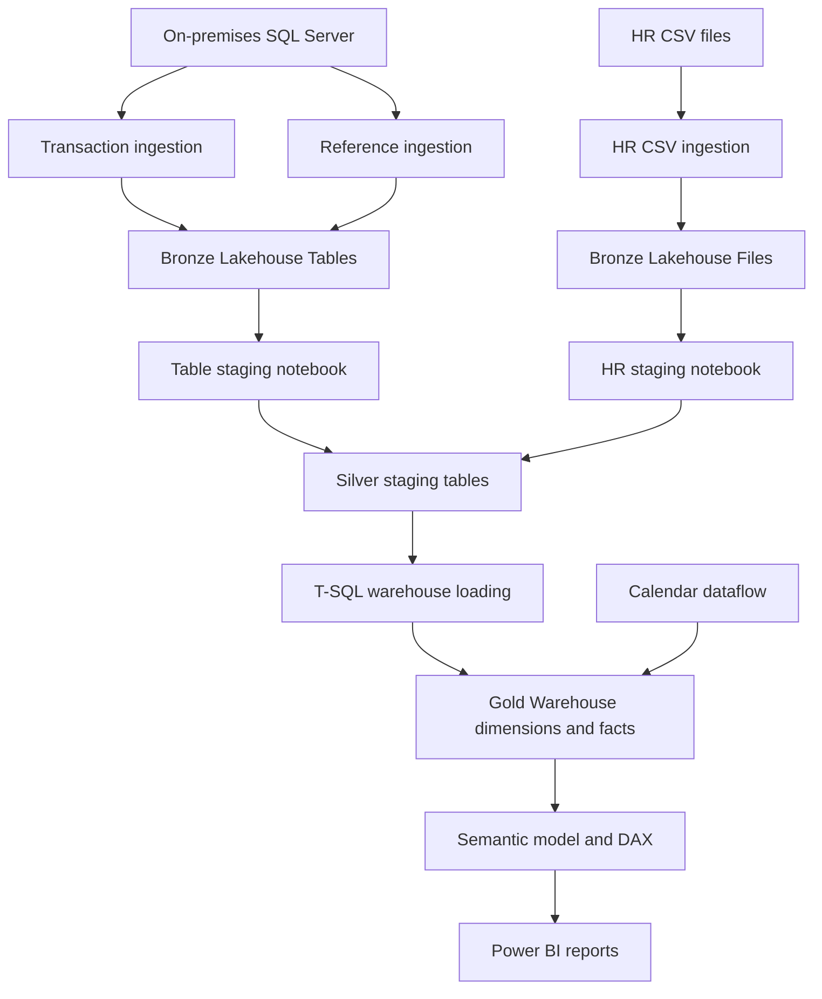
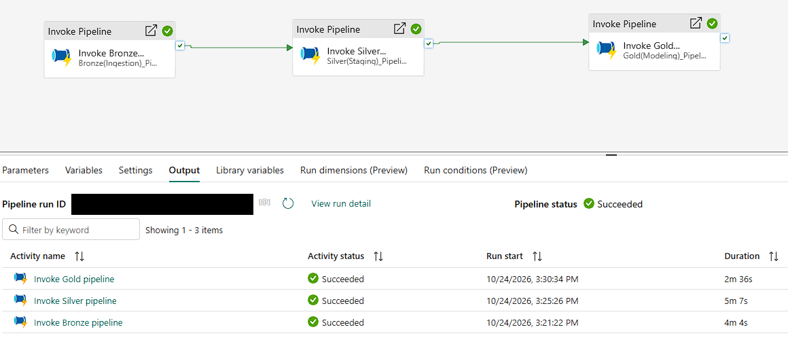
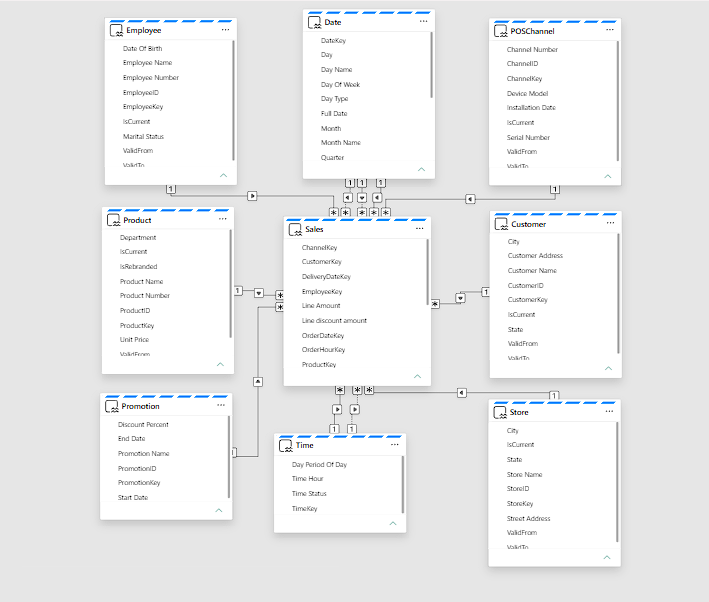

# Retail Operations Analytics with Microsoft Fabric

A retail analytics platform integrating operational data into Bronze and Silver lakehouses, a Gold dimensional Warehouse, and Power BI reporting.

I independently designed and implemented the Fabric solution from a business case introduced during structured data warehousing and BI training.

## Business questions and analysis contribution

- What sells each day, and how does promotional sales mix differ?
- Which products appear together, and which vendors deliver sooner?
- How do demand, workforce activity, and revenue/cost patterns vary over time?

I translated supplied requirements into transformation rules, fact/dimension models, KPI definitions, and report designs. The [requirements trace](documentation/requirements-traceability.md) connects those decisions to implementation; the [KPI glossary](documentation/dashboard-design.md) records grains, assumptions, and open questions.

## Architecture

A master pipeline invokes Bronze, Silver, then Gold through completion dependencies. [Architecture details and editable sources](architecture/README.md) explain the flow.

## Engineering highlights

- **Different ingestion strategies:** [transaction copies](pipelines/Ingest_Transaction_Tables.CopyJob/copyjob-content.json) configure snapshot-plus-incremental reads; [references](pipelines/Ingest_Reference_Tables.CopyJob/copyjob-content.json) overwrite. [Ingestion details](documentation/data-engineering.md) distinguish these from HR file handling and Gold watermarks.
- **Two transformation paths:** [table](notebooks/Tables_Staging_Notebook.Notebook/notebook-content.py) and [HR file](notebooks/Files_Staging_Notebook.Notebook/notebook-content.py) notebooks converge into Silver staging.
- **Dimensional loading:** the [Sales procedure](sql/dbo/StoredProcedures/sp_LoadFactSales.sql) illustrates grain/key checks, dimension resolution, and business-date watermarks.
- **Orchestration and monitoring:** [master dependencies](pipelines/Master_ETL_Pipeline.DataPipeline/pipeline-content.json), notebook/job outputs, and [audit writing](sql/dbo/StoredProcedures/sp_WritePipelineAudit.sql) connect the layers.

| Technology | Role |
|---|---|
| SQL Server / FileServer | Operational tables and HR CSV sources |
| Fabric Copy Jobs / pipelines | Ingestion and orchestration |
| Lakehouses / PySpark / Spark SQL | Landing and conformance |
| Warehouse / T-SQL | Dimensions, facts, and load controls |
| Power Query | Calendar generation |
| Direct Lake / DAX / Power BI | Semantic model and analytics |

## Execution evidence

Existing run, October 24, 2026: all three invoked pipelines succeeded. Run identifier redacted. [Evidence boundaries and logs](documentation/validation.md) distinguish execution from correctness.

## Sales relationship layout

Sales is one subject-area layout within the shared model. [Model documentation](documentation/data-model.md) explains all five layouts, exact relationship columns, and date/time roles.

## Explore

| Area | Evidence |
|---|---|
| [Business requirements](documentation/business-requirements.md) | Context, scope, and supplied analytical needs |
| [Architecture](architecture/README.md) | Flow and editable diagrams |
| [Notebooks](notebooks/README.md) / [pipelines](pipelines/README.md) | Transformations and dependencies |
| [SQL](sql/README.md) / [data model](documentation/data-model.md) | Dimensions, facts, and selected loaders |
| [Power BI](powerbi/README.md) / [dashboard design](documentation/dashboard-design.md) | Model, measures, qualified report images |
| [Validation](documentation/validation.md) / [setup](documentation/setup.md) | Checks and reproduction limits |
| [Screenshots](screenshots/README.md) / [sample data](data/sample-data/README.md) | Reviewed captures and fictional examples |

## Validation and limitations

Screenshots support existing-project execution; local examples check fictional calculations and reproduce known limitations. Detailed correctness reconciliations and exact source/deployment correspondence remain pending.

Historical attribution, late arrivals, HR ordering, basket keys, and financial/KPI assumptions need review. Distance-based vendor analysis is missing; descriptive comparisons are not causal. This sanitized code showcase requires environment configuration and is not an import-ready deployment. [Validation details](documentation/validation.md) retain the unresolved issues.
