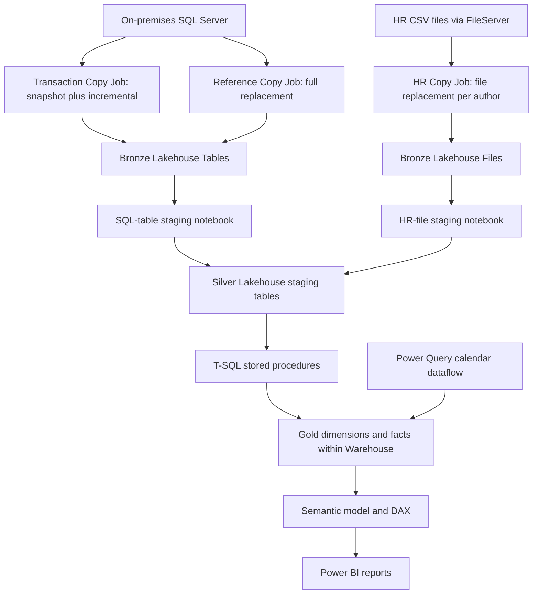

# Source-to-report architecture

[Overview](../README.md) | [Engineering examples](../documentation/data-engineering.md) | [Model](../documentation/data-model.md)

[Editable flow source](source-to-report.mmd) | [Selected star-schema diagram](data-model.md) | [Editable overview source](overview.mmd)

## Responsibilities and dependencies

| Component | Observed role and boundary |
|---|---|
| SQL Server and FileServer connections | Reference/transaction ingestion and six HR CSV inputs. Credentials, gateway setup, and actual source services are external. |
| Bronze lakehouse | Raw inputs; reference copies overwrite, so this is not a universally immutable archive. |
| Silver lakehouse | Spark SQL and PySpark normalize fields, rank selected reference records, parse HR dates, apply daily rules, and replace staging tables. |
| Gold Warehouse | T-SQL dimensions, six facts, load control, and audit tables. Dimensional models reside here, not in a third Gold lakehouse. |
| Date dataflow | Generates dates from 2014 through the current year and feeds Warehouse calendar staging. |
| Model/report | Direct Lake entity partitions plus imported helpers/calculation groups; DAX and report definitions provide analytical behavior. |

The [master pipeline](../pipelines/Master_ETL_Pipeline.DataPipeline/pipeline-content.json) waits for Bronze, then Silver, then Gold. Bronze invokes three Copy Jobs. Silver has parallel table/file notebooks and audit branches. Gold runs dimension/calendar preparation before its chained fact activities. The serialized source schedule was daily at 01:00 Mountain time, but no schedule is exported or activated here.

Run IDs, counts, statuses, and error messages flow to the Warehouse audit procedure. Dependencies in JSON prove intended sequencing, not independently observed run success or failure propagation.

## Actual configuration approach

The source project contains Fabric Git artifacts, explicit notebook/workspace bindings, and a Warehouse SQL project. Its Azure DevOps remote remains private and unchanged. No infrastructure-as-code provisioning or CI/CD pipeline was established. Workspace permissions, connections, gateway configuration, capacity, and source setup are outside the repository's verification boundary.

This showcase contains selected readable definitions, not an import-ready export. Organization references and environment identifiers/endpoints were substituted consistently; original-to-placeholder mappings are not published. Activity names, expressions, table names, and dependency relationships retain source intent. Synthetic identifiers and `example.invalid` bindings cannot connect to a working environment. A separate deployment is not required for this portfolio review.

## Version boundary

All linked main examples preserve the existing repository implementation's behavior. The inspected master screenshot shows successful Bronze, Silver, and Gold invocations. Exact source-to-deployment correspondence remains unverified. See [ingestion details](../documentation/data-engineering.md) and [reviewed screenshots](../screenshots/README.md).

## Ingestion distinctions

Transaction Copy Job definitions use CDC mode with SnapshotPlusIncremental and TransactionID settings; explicit persisted source watermark state is not exported. Reference tables overwrite. HR replacement behavior is author-confirmed; exported batch file settings do not independently prove repeat-copy overwrite semantics. These source mechanisms differ from Gold FactLoadControl business-date watermarks. Gateway and connection configuration remain external and unverified.
