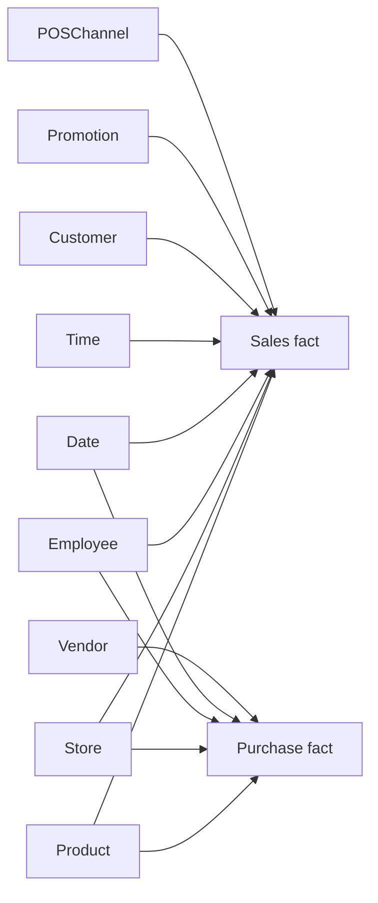

# Selected star relationships

[Architecture](README.md) | [Model documentation](../documentation/data-model.md) | [Editable Mermaid source](data-model.mmd)

This is a selected source-defined model view, not an inspected deployed-model screenshot. See the model documentation for omitted relationships, date roles, and historical attribution limits.
