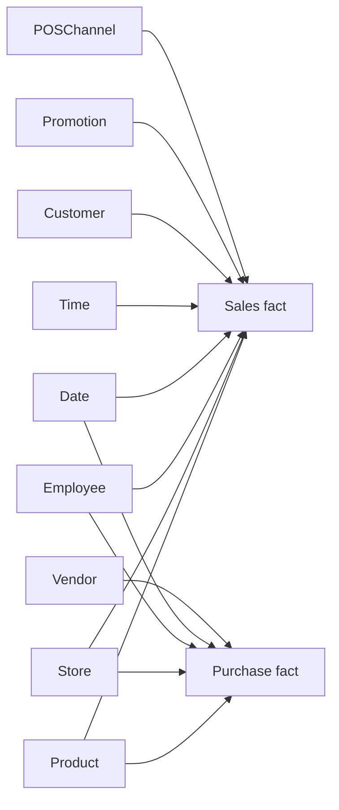

# Selected star relationships

[Portfolio overview](../README.md) | [Model documentation](../documentation/data-model.md) | [Editable Mermaid source](data-model.mmd)

Selected Sales/Purchase star relationships. The [model documentation](../documentation/data-model.md) covers all five subject areas, date roles, and historical attribution.
