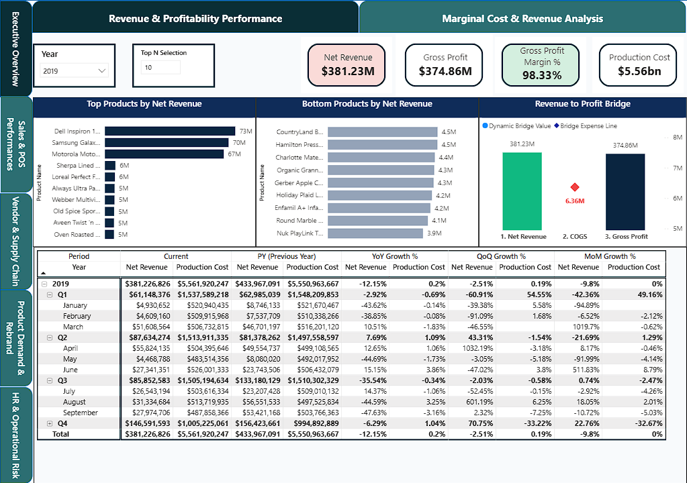

# Semantic model, KPI glossary, and report topics

[Overview](../README.md) | [Requirements](requirements-traceability.md) | [Data model](data-model.md) | [Validation](validation.md)

## Evidence and version

The [model definition](<../powerbi/Retail Analytics Model.SemanticModel/definition/model.tmdl>), [relationships](<../powerbi/Retail Analytics Model.SemanticModel/definition/relationships.tmdl>), [measures](<../powerbi/Retail Analytics Model.SemanticModel/definition/tables/_Measures.tmdl>), [Time Intelligence group](<../powerbi/Retail Analytics Model.SemanticModel/definition/tables/Time Intelligence.tmdl>), and other definition files preserve existing implementation behavior, with confidentiality substitutions only.

Warehouse tables configure Direct Lake partitions. Imported helper/calculation-group definitions support selections and period comparisons. Direct Lake configuration does not prove effective runtime mode, refresh success, security configuration, or correct numerical results. Alternative date relationships are activated by selected measures through USERELATIONSHIP.

The report excerpts contain the relative model reference and two page configurations only, under [report-excerpts](../powerbi/report-excerpts/README.md). It is **not an importable report**: visuals, theme, and full report packaging are intentionally omitted. Dashboard appearance is now evidenced by the supplied, cropped existing-project screenshots; data publication approval remains pending.

## KPI glossary

"Source verified" means the formula exists and was inspected. It does not mean the live business value was validated. All metrics inherit model/filter context unless their formula explicitly removes or changes it. Currency and tax treatment need confirmation before financial interpretation.

| KPI / source formula | Grain and filters | Assumptions and business use | Validation status |
|---|---|---|---|
| Gross Sales = SUM(Sales[Line Amount]) | Sales rows within selected dates, products, stores, etc. | Line amount represents gross sales before separately stored discount. Product/store movement comparison. | Source verified; live totals pending. |
| Net Sales = Gross Sales - Total Discounts | Same selected sales rows | Discount is separately subtractable; do not subtract twice if source line amount is already net. Revenue comparison, not validated profit. | Source verified; synthetic arithmetic only. |
| Total Orders = DISTINCTCOUNT(Sales[TransactionNumber]) | Distinct order numbers in current context | Order number must identify an order across stores/channels; blank/duplicate numbering policy unverified. Transaction-volume comparison. | Source verified; synthetic count only. |
| Store Average Order Value = Store Net Sales / Store Transaction Count | Selected sales context, grouped by store where requested | Uses the same distinct-order assumption. Zero denominator returns 0 through DIVIDE. Basket-value comparison. | Source verified; synthetic arithmetic only. |
| Store Units Per Transaction = SUM(Sales[Quantity]) / Store Transaction Count | Units per distinct order in selected context | Quantity is in comparable units. This is one precise definition of average basket size. | Source verified; synthetic arithmetic only. |
| Store Items Per Basket = COUNTROWS(Sales) / Store Transaction Count | Sales lines per order, not units | A row is a sales line; split lines affect this value. Distinguish from units/order. | Source verified; synthetic arithmetic only. |
| Promo Sales Share % = Promo Sales / Net Sales | Promo Sales filters Promotion Name other than No Discount | Promotion labels classify sales; share describes mix. It does not isolate a promotion's causal effect. | Source verified; live values pending. |
| Total Purchase Amount = SUM(Purchase[Line Amount]) | Purchase rows under selected vendor/store/product/date filters | Purchase spending, not established cost of goods sold. Procurement comparison. | Source verified; synthetic total only. |
| Avg Vendor Delivery Days | AVERAGEX over purchase rows using order/delivery keys | Line-weighted duration, not necessarily average per order. Vendor comparison requires comparable orders/product mix. | Source verified; live dates/context pending. |
| Total Absent Hours / Total Overtime Hours | Sum of fact hours in selected context | Depends on retained HR records and historical employee attribution. Workforce trend description. | Source verified; live totals pending. |
| Gross Profit Margin % = (Net Revenue - COGS) / Net Revenue | Selected model context; COGS requires one selected year | COGS uses a purchasing-average calculation. Not independently validated inventory costing or accounting margin. | Formula exists; **not a validated showcase KPI**. |

The existing model includes product rankings and store sales comparisons; grouping sales by Store State can support regional views. There is no inspected dedicated regional-growth KPI, so do not advertise one as a verified measure. Product performance is evidenced by units/sales/rank measures, not proven commercial improvement.

## Candidate metrics that are not established

- **Customer retention:** no dedicated returning-customer/cohort retention definition was found. Future improvement.
- **Customer order frequency:** Total Orders exists, but no verified orders-per-customer/per-time-window KPI was established. Future improvement.
- **Financial margin/COGS:** implemented formulas require accounting validation; purchase spending plus tax must not be relabeled validated manufacturing cost or COGS.
- **Nearest vendor:** no geographic distance/routing analysis exists. Future improvement.
- **Causal promotional/rebranding impact:** descriptive ratios/cohorts exist; causal attribution is not implemented.

The original late-delivery rate mixes line-count numerator and order-count denominator. The basket helper lacks a ProductKey referenced by some measures. Device metrics and absence-rate assumptions also need review. These original behaviors remain in the exported code and are listed in [limitations](validation.md).

## Report-page topics and decisions

| Existing page name | Intended analytical use |
|---|---|
| Daily Sales Movement | Daily product movement and promotion sales mix |
| Market Basket | Co-purchase exploration, subject to basket/model validation |
| Vendor & Supply Chain | Product purchasing patterns and delivery durations |
| Time-of-Day Demand | Product demand across hourly periods |
| POS Replacements | Device change frequency, subject to detection/filter limitations |
| Rebranding Impact | Descriptive product-version comparisons |
| Employee Overtime | Hours across employee attributes; historical attribution caveat |
| Employee Misconduct | Incident trends using retained daily records |
| Employee Absenteeism | Hours/incidents; rate definition needs review |
| Revenue & Profitability Performance | Revenue/financial comparisons with accounting caveats |
| Marginal Cost & Revenue Analysis | Period-change ratios with chronology/context caveats |

Eleven page definitions exist; ten are hidden in view mode. That may be intentional navigation. The supplied profitability and marginal page appearances were inspected; corresponding source visual measure references were reviewed. Live navigation, exact version identity, and displayed-value correctness remain unverified. [Screenshot instructions](../screenshots/README.md) specify the evidence needed without misrepresenting code versions.

## Supplied dashboard evidence

**Report-design evidence only:** displayed margin, COGS, and purchasing-cost bases remain unreconciled; these figures are not validated financial outcomes. The pictured data is not established as synthetic.

[Profitability page](../screenshots/dashboards/revenue-profitability.png) and [marginal analysis page](../screenshots/dashboards/marginal-cost-revenue.png) demonstrate rendered layout and visual choices only. Revenue/profit/COGS versus purchasing-spend bases and marginal quantity/period assumptions remain unresolved; do not use displayed figures as validated outcomes. See [precise reconciliation proposals](financial-reconciliation.md). Recommend a reconciled Daily Sales Movement page for the lead analytical image.
