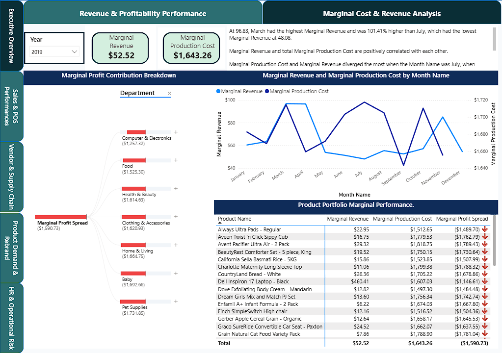

# Analytics, KPI definitions, and dashboard design

[Overview](../README.md) | [Business requirements](business-requirements.md) | [Data model](data-model.md) | [Validation](validation.md)

## Semantic model

The [model definition](<../powerbi/Retail Analytics Model.SemanticModel/definition/model.tmdl>) brings shared Warehouse dimensions/facts into Direct Lake entity partitions. [Measures](<../powerbi/Retail Analytics Model.SemanticModel/definition/tables/_Measures.tmdl>), helper tables, and calculation groups support product, store, vendor, workforce, and period analysis. [Time Intelligence](<../powerbi/Retail Analytics Model.SemanticModel/definition/tables/Time Intelligence.tmdl>) includes previous-year/quarter/month values, changes, and growth calculations.

[Relationships](<../powerbi/Retail Analytics Model.SemanticModel/definition/relationships.tmdl>) define active and alternative date/hour roles. Selected measures use USERELATIONSHIP for Purchase delivery and ship dates. The [data model](data-model.md) documents exact columns and shared filter paths.

## KPI glossary

Definitions below come from retained DAX. Metrics use the current model/filter context unless explicitly changed. [Local examples](validation.md) check selected fictional arithmetic; live totals and financial costing still need reconciliation.

| KPI / source formula | Grain and filters | Assumptions and business use |
|---|---|---|
| Gross Sales = SUM(Sales[Line Amount]) | Sales rows within selected dates, products, stores, etc. | Line amount represents gross sales before separately stored discount. Product/store movement comparison. |
| Net Sales = Gross Sales - Total Discounts | Same selected sales rows | Discount is separately subtractable; do not subtract twice if source line amount is already net. Revenue comparison, not validated profit. |
| Total Orders = DISTINCTCOUNT(Sales[TransactionNumber]) | Distinct order numbers in current context | Order number must identify an order across stores/channels; blank/duplicate numbering policy unverified. Transaction-volume comparison. |
| Store Average Order Value = Store Net Sales / Store Transaction Count | Selected sales context, grouped by store where requested | Uses the same distinct-order assumption. Zero denominator returns 0 through DIVIDE. Basket-value comparison. |
| Store Units Per Transaction = SUM(Sales[Quantity]) / Store Transaction Count | Units per distinct order in selected context | Quantity is in comparable units. This is one precise definition of average basket size. |
| Store Items Per Basket = COUNTROWS(Sales) / Store Transaction Count | Sales lines per order, not units | A row is a sales line; split lines affect this value. Distinguish from units/order. |
| Promo Sales Share % = Promo Sales / Net Sales | Promo Sales filters Promotion Name other than No Discount | Promotion labels classify sales; share describes mix. It does not isolate a promotion's causal effect. |
| Total Purchase Amount = SUM(Purchase[Line Amount]) | Purchase rows under selected vendor/store/product/date filters | Purchase spending, not established cost of goods sold. Procurement comparison. |
| Avg Vendor Delivery Days | AVERAGEX over purchase rows using order/delivery keys | Line-weighted duration, not necessarily average per order. Vendor comparison requires comparable orders/product mix. |
| Total Absent Hours / Total Overtime Hours | Sum of fact hours in selected context | Depends on retained HR records and historical employee attribution. Workforce trend description. |
| Gross Profit Margin % = (Net Revenue - COGS) / Net Revenue | Selected model context; COGS requires one selected year | COGS uses a purchasing-average calculation. Not independently validated inventory costing or accounting margin. |

Product rankings, store comparisons, and grouping by Store State support product and regional exploration. Customer retention and customer-specific order-frequency measures are [future improvements](business-requirements.md), rather than completed KPIs.

## Report topics and decisions

| Existing page name | Intended analytical use |
|---|---|
| Daily Sales Movement | Daily product movement and promotion sales mix |
| Market Basket | Co-purchase exploration, subject to basket/model validation |
| Vendor & Supply Chain | Product purchasing patterns and delivery durations |
| Time-of-Day Demand | Product demand across hourly periods |
| POS Replacements | Device change frequency, subject to detection/filter limitations |
| Rebranding Impact | Descriptive product-version comparisons |
| Employee Overtime | Hours across employee attributes; historical attribution caveat |
| Employee Misconduct | Incident trends using retained daily records |
| Employee Absenteeism | Hours/incidents; rate definition needs review |
| Revenue & Profitability Performance | Revenue/financial comparisons with accounting caveats |
| Marginal Cost & Revenue Analysis | Period-change ratios with chronology/context caveats |

The report metadata describes eleven page topics, including hidden pages. Two illustrative page configurations ([revenue/profitability](../powerbi/report-excerpts/revenue-profitability-page.json) and [marginal analysis](../powerbi/report-excerpts/marginal-cost-revenue-page.json)) are retained alongside the semantic model. The screenshots show rendered report design; the complete report visuals/theme package is not included.

## Report-design evidence

Cards, Top/Bottom N product rankings, a financial bridge, and a period matrix provide an executive comparison view. **Displayed financial figures are not reconciled outcomes**: purchasing spend and calculated COGS use different bases. See [financial reconciliation](financial-reconciliation.md).

The marginal page combines cards, trends, a breakdown, and product detail. Quantity/date bases and prior-period selection remain review concerns. The source issues and design limits affecting other analytical areas are centralized in [validation](validation.md).
