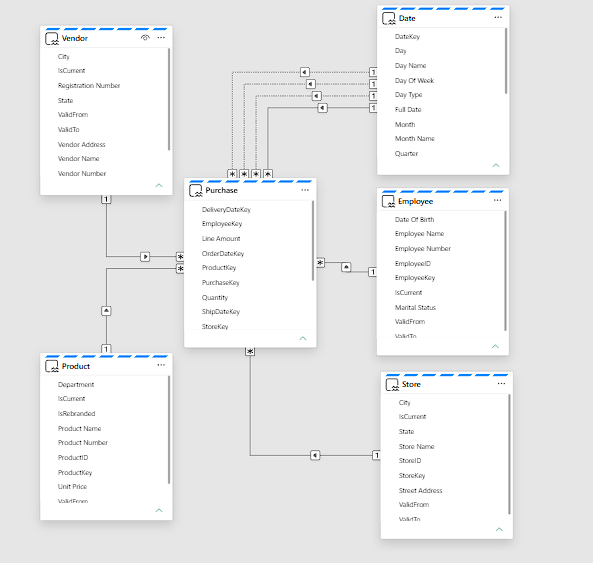
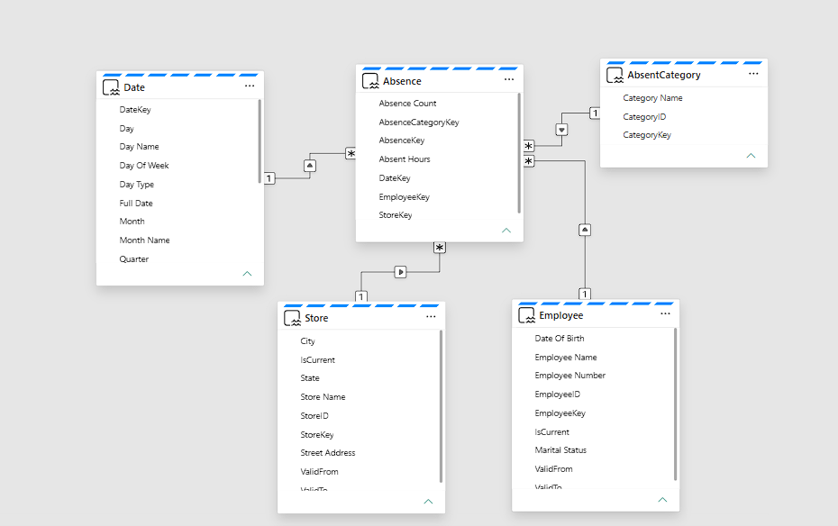
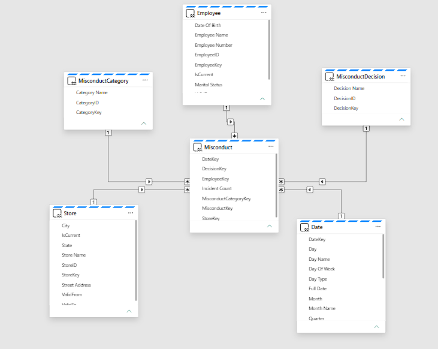
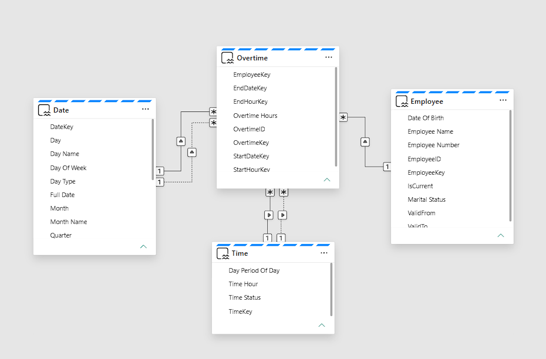

# Dimensional model and loading examples

[Portfolio overview](../README.md) | [Engineering](data-engineering.md) | [Semantic model/KPIs](dashboard-design.md)

The Gold Warehouse contains six facts and thirteen dimensions. The semantic model shares dimensions across analytical subject areas; selected SQL loaders illustrate version tracking and incremental loading.

## Selected star relationships

[View the selected star-schema diagram](../architecture/data-model.md) and its [editable Mermaid source](../architecture/data-model.mmd).

This simplified diagram shows selected relationships present in the semantic definitions. Arrows indicate dimension-to-fact context, not a complete cardinality or deployment diagram. [Relationship source](<../powerbi/Retail Analytics Model.SemanticModel/definition/relationships.tmdl>) includes inactive date/hour roles. The original POSDeviceChange fact lacks corresponding semantic date/channel relationships; this diagram does not imply otherwise.

## Facts and intended grains

Grains are inferred from source definitions/loaders and need data-level uniqueness validation.

| Fact definition | Intended grain/context |
|---|---|
| [Sales](../sql/fact/Tables/Sales.sql) | Source transaction ID with product-line attributes; order number groups lines. |
| [Purchase](../sql/fact/Tables/Purchase.sql) | Source purchase transaction ID; vendor, product, store, and multiple date roles. |
| [Overtime](../sql/fact/Tables/Overtime.sql) | Employee overtime event. |
| [Absence](../sql/fact/Tables/Absence.sql) | Retained employee-day record, aggregated by dimensional context. |
| [Misconduct](../sql/fact/Tables/Misconduct.sql) | Retained employee-day incident, aggregated by category/decision context. |
| [POSDeviceChange](../sql/fact/Tables/POSDeviceChange.sql) | Derived channel/device change event; original detection and filtering need review. |

Shared dimensions are Product, Store, Employee, Date, and Time where applicable. Other definitions include Vendor, Customer, Promotion, POSChannel, absence/misconduct categories and decisions, and Product_Basket. All 13 dimension definitions are retained under `sql/dim/Tables/`. Calendar keys are date-derived; entity dimensions use surrogate keys where defined.

## History and attribute replacement

- [Product SCD2 loader](../sql/dbo/StoredProcedures/sp_LoadDimProduct_SCD2.sql), [Vendor SCD2 loader](../sql/dbo/StoredProcedures/sp_LoadDimVendor_SCD2.sql), and [Employee SCD2 loader](../sql/dbo/StoredProcedures/sp_LoadDimEmployee_SCD2.sql) expire changed versions and insert current rows with ValidFrom/ValidTo/IsCurrent. SCD2 means retaining successive attribute versions.
- [Promotion loader](../sql/dbo/StoredProcedures/sp_LoadDimPromotion.sql) demonstrates full replacement of lookup attributes: Type 1-style replacement rather than retained history. The delete/reinsert method replaces surrogate keys; [rerun integrity](validation.md) is an open check.
- [Sales](../sql/dbo/StoredProcedures/sp_LoadFactSales.sql), [Purchase](../sql/dbo/StoredProcedures/sp_LoadFactPurchase.sql), and [Overtime](../sql/dbo/StoredProcedures/sp_LoadFactOvertime.sql) illustrate dimension resolution and watermark-based loading.

## Historical attribution scope

The SCD2 loaders retain observed attribute versions using ValidFrom, ValidTo, and IsCurrent. Fact loaders select current dimension rows rather than event-date validity intervals. Backfilled events can therefore receive current attributes; the retained timestamps describe observation/load time. This affects rebranding, vendor-change, and employee-status comparisons. [Validation](validation.md) distinguishes source issues from remaining execution checks.

## Observed deployed object inventories

The supplied [dimensions](../screenshots/models/warehouse-dimensions.png), [facts](../screenshots/models/warehouse-facts.png), and [procedures](../screenshots/models/warehouse-stored-procedures.png) captures show object inventories. They do not establish model relationships, correct keys, or exact source-version correspondence.

## Semantic-model subject-area layouts

The repository contains one `Retail Analytics Model.SemanticModel` definition referencing Sales, Purchase, Absence, Misconduct, and Overtime, with their relationships in one shared file. The five captures show **subject-area layouts of this shared model**. They are not separate models or secured perspectives.

The captures show dimension `1` to fact `*` paths. The source declares exact endpoints and inactive flags, while omitting cardinality/filter overrides. Tables below use the default many-to-one, dimension-to-fact filter interpretation, consistent with the images and [Microsoft TMDL guidance](https://github.com/microsoft/skills-for-fabric/blob/main/skills/semantic-model-authoring/references/tmdl-guidelines.md).

Solid paths are active; dotted paths are inactive. Active paths filter by default; inactive paths require explicit activation in a calculation to apply that role. Selected DAX activates Purchase delivery and ship date roles with USERELATIONSHIP.

**Shared dimensions:** Date and Employee relate to all five facts. Store is shared by Sales, Purchase, Absence, and Misconduct; Product by Sales and Purchase; Time by Sales and Overtime. Vendor is Purchase-specific in these views. Customer, Promotion, and POSChannel provide Sales context; category/decision lookups specialize HR analysis. No direct fact-to-fact relationship is declared in these 33 paths.

The [relationship definitions](<../powerbi/Retail Analytics Model.SemanticModel/definition/relationships.tmdl>) supply the exact columns and active/inactive flags below.

### Sales

Sales shares Product, Store, Employee, Date, and Time with other areas and adds Customer, Promotion, and POSChannel. Transaction date/hour are the default roles; order/delivery dates and order hour are inactive.

| Fact column | Dimension column | Status |
|---|---|---|
| `Sales.ChannelKey` | `POSChannel.ChannelKey` | Active |
| `Sales.CustomerKey` | `Customer.CustomerKey` | Active |
| `Sales.DeliveryDateKey` | `Date.DateKey` | Inactive |
| `Sales.EmployeeKey` | `Employee.EmployeeKey` | Active |
| `Sales.PromotionKey` | `Promotion.PromotionKey` | Active |
| `Sales.TransactionHourKey` | `Time.TimeKey` | Active |
| `Sales.StoreKey` | `Store.StoreKey` | Active |
| `Sales.OrderDateKey` | `Date.DateKey` | Inactive |
| `Sales.TransactionDateKey` | `Date.DateKey` | Active |
| `Sales.OrderHourKey` | `Time.TimeKey` | Inactive |
| `Sales.ProductKey` | `Product.ProductKey` | Active |

### Purchase

Purchase shares Product, Store, Employee, and Date and adds Vendor. Transaction date is active; order, delivery, and ship dates are alternative inactive roles.

| Fact column | Dimension column | Status |
|---|---|---|
| `Purchase.DeliveryDateKey` | `Date.DateKey` | Inactive |
| `Purchase.OrderDateKey` | `Date.DateKey` | Inactive |
| `Purchase.ShipDateKey` | `Date.DateKey` | Inactive |
| `Purchase.TransactionDateKey` | `Date.DateKey` | Active |
| `Purchase.EmployeeKey` | `Employee.EmployeeKey` | Active |
| `Purchase.StoreKey` | `Store.StoreKey` | Active |
| `Purchase.VendorKey` | `Vendor.VendorKey` | Active |
| `Purchase.ProductKey` | `Product.ProductKey` | Active |

### Absence

Absence relates to Date, Employee, Store, and AbsentCategory. All four declared paths are active; no separate inactive date/time role is defined for this fact.

| Fact column | Dimension column | Status |
|---|---|---|
| `Absence.AbsenceCategoryKey` | `AbsentCategory.CategoryKey` | Active |
| `Absence.DateKey` | `Date.DateKey` | Active |
| `Absence.EmployeeKey` | `Employee.EmployeeKey` | Active |
| `Absence.StoreKey` | `Store.StoreKey` | Active |

### Misconduct

Misconduct relates to Date, Employee, Store, MisconductCategory, and MisconductDecision. All five paths are active; the decision/category keys are distinct business contexts.

| Fact column | Dimension column | Status |
|---|---|---|
| `Misconduct.DecisionKey` | `MisconductDecision.DecisionKey` | Active |
| `Misconduct.EmployeeKey` | `Employee.EmployeeKey` | Active |
| `Misconduct.MisconductCategoryKey` | `MisconductCategory.CategoryKey` | Active |
| `Misconduct.StoreKey` | `Store.StoreKey` | Active |
| `Misconduct.DateKey` | `Date.DateKey` | Active |

### Overtime

Overtime shares Employee, Date, and Time. Start date/hour are active, while end date/hour are inactive alternatives. There is no Store relationship for Overtime in this source.

| Fact column | Dimension column | Status |
|---|---|---|
| `Overtime.EmployeeKey` | `Employee.EmployeeKey` | Active |
| `Overtime.StartDateKey` | `Date.DateKey` | Active |
| `Overtime.EndDateKey` | `Date.DateKey` | Inactive |
| `Overtime.StartHourKey` | `Time.TimeKey` | Active |
| `Overtime.EndHourKey` | `Time.TimeKey` | Inactive |

### Image detail and validation

Borders were cropped without changing model content. Sales, Purchase, and Misconduct field labels are small; larger captures with expanded cards would improve inspection. Absence and Overtime are clearer at native size. Hidden card fields are covered by the source mapping above. [Validation](validation.md) records the remaining history, key-integrity, and DAX checks.
